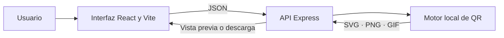

<pre align="center" role="img" aria-label="CHXCHX QR">
 ██████╗██╗  ██╗██╗  ██╗ ██████╗██╗  ██╗██╗  ██╗      ██████╗ ██████╗
██╔════╝██║  ██║╚██╗██╔╝██╔════╝██║  ██║╚██╗██╔╝     ██╔═══██╗██╔══██╗
██║     ███████║ ╚███╔╝ ██║     ███████║ ╚███╔╝█████╗██║   ██║██████╔╝
██║     ██╔══██║ ██╔██╗ ██║     ██╔══██║ ██╔██╗╚════╝██║▄▄ ██║██╔══██╗
╚██████╗██║  ██║██╔╝ ██╗╚██████╗██║  ██║██╔╝ ██╗     ╚██████╔╝██║  ██║
 ╚═════╝╚═╝  ╚═╝╚═╝  ╚═╝ ╚═════╝╚═╝  ╚═╝╚═╝  ╚═╝      ╚══▀▀═╝ ╚═╝  ╚═╝
</pre>

<p align="center">
  Generador de códigos QR estáticos, personalizables y listos para descargar.
  <br />
  Interfaz web en español · API propia · Sin base de datos ni proveedor QR externo
</p>

<p align="center">
  <a href="https://github.com/chxchx-dev/chxchx-qr/actions/workflows/ci.yml"></a>
  <a href="LICENSE"></a>
  
  
</p>

<p align="center">
  <a href="#inicio-rápido">Inicio rápido</a> ·
  <a href="#qué-puedes-generar">Funciones</a> ·
  <a href="#api">API</a> ·
  <a href="#despliegue">Despliegue</a> ·
  <a href="#contribuir">Contribuir</a>
</p>

**chxchx-qr** permite crear, validar, previsualizar y descargar códigos QR desde una aplicación web. El contenido se envía a la API que configures para generar el código; la API no guarda las solicitudes ni depende de un servicio QR externo.

> Los QR son estáticos: el contenido queda codificado en el propio código. Si cambia el enlace o los datos, genera y distribuye un nuevo QR.

## Qué puedes generar

| Tipo | Contenido |
| --- | --- |
| Texto | Texto libre, incluidos saltos de línea |
| Enlace | URL `http` o `https` |
| Correo | Dirección, asunto y cuerpo |
| Teléfono y SMS | Número y, para SMS, mensaje opcional |
| Wi-Fi | Red, contraseña, seguridad y red oculta |
| Contacto | Datos de contacto en formato vCard |
| Evento | Título, fechas, ubicación y descripción |
| Ubicación | Coordenadas y etiqueta opcional |

También puedes elegir el formato y nombre de archivo, copiar el contenido QR, ajustar el tamaño, el margen, los colores y el nivel de corrección de errores. La validación avisa sobre problemas de capacidad, densidad y contraste antes de exportar.

| Formato | Ideal para |
| --- | --- |
| **SVG** | Gráficos vectoriales que puedes escalar sin perder nitidez |
| **PNG** | Imágenes de alta resolución para documentos y web |
| **GIF** | Imagen raster sencilla y compatible |

## Inicio rápido

### Requisitos

- Node.js **24** recomendado; se admite `>=20.19.0`.
- npm.

### Ejecutar localmente

```bash
git clone https://github.com/chxchx-dev/chxchx-qr.git
cd chxchx-qr
npm ci
npm run dev
```

Abre **[http://localhost:5173](http://localhost:5173)**. La API de desarrollo escucha en **[http://localhost:4000](http://localhost:4000)**. No necesitas crear archivos `.env` para usar los valores predeterminados.

### Cómo usar la aplicación

1. Elige el tipo de contenido y completa los campos.
2. Revisa la validación y la vista previa del QR.
3. Personaliza las opciones, selecciona SVG, PNG o GIF y descarga el archivo; también puedes copiar el contenido codificado.

## Personalización

| Opción | Valores admitidos | Predeterminado |
| --- | --- | --- |
| Corrección de errores | Bajo (7 %), medio (15 %), alto (25 %) o máximo (30 %) | Medio |
| Tamaño de salida | 128–4096 px | 1024 px |
| Margen | 0–16 módulos | 4 módulos |
| Colores | Hexadecimal `#RGB` o `#RRGGBB` | Negro sobre blanco |

Un nivel de corrección mayor puede reducir cuánto contenido cabe en el QR. Para imprimir, conserva una zona blanca alrededor del código y usa colores con alto contraste.

## Cómo funciona

La interfaz React envía el contenido a la API configurada. La API valida la entrada y usa el motor local `@chxchx/qr-core` para crear la vista previa o el archivo de descarga.



No se requiere una base de datos, almacenamiento persistente ni un proveedor QR externo. Si alojas la aplicación, el contenido sí se procesa en la API que hayas configurado; revisa la sección de [privacidad](#privacidad) antes de compartir datos sensibles.

## API

La API está versionada bajo `/api/v1`. Incluye validación antes de renderizar, errores `application/problem+json`, límite de solicitudes por IP y encabezado `X-Request-Id`.

| Método y ruta | Uso |
| --- | --- |
| `GET /health/live` | Comprueba que la API responde |
| `GET /health/ready` | Comprueba que el motor está disponible |
| `POST /api/v1/qr/validate` | Valida contenido y opciones; devuelve advertencias y recomendaciones |
| `POST /api/v1/qr/render` | Genera el archivo solicitado como descarga |

Ejemplo: validar una URL y generar el QR en SVG:

```bash
curl -X POST http://localhost:4000/api/v1/qr/validate \
  -H "Content-Type: application/json" \
  -d '{"content":{"type":"url","url":"https://example.com"},"options":{"ecc":"medium","size":512}}'

curl -X POST http://localhost:4000/api/v1/qr/render \
  -H "Content-Type: application/json" \
  -d '{"content":{"type":"url","url":"https://example.com"},"options":{"format":"svg","size":512}}' \
  --output ejemplo.svg
```

Consulta el [contrato de la API](docs/API.md) para los esquemas, opciones, respuestas y errores.

## Comandos de desarrollo

| Comando | Acción |
| --- | --- |
| `npm run dev` | Compila paquetes compartidos e inicia la web y la API |
| `npm run build` | Compila todos los paquetes y las aplicaciones |
| `npm run typecheck` | Comprueba los tipos TypeScript |
| `npm run lint` | Revisa código y formato con Biome |
| `npm run format:check` | Comprueba el formato sin modificar archivos |
| `npm test` | Ejecuta las pruebas unitarias e integración |
| `npm run test:coverage` | Ejecuta las pruebas con cobertura |
| `npm run test:e2e` | Ejecuta las pruebas de navegador con Playwright |
| `npm run audit` | Audita las dependencias de producción |

Para las pruebas de navegador, instala Chromium con `npx playwright install chromium`. El comando E2E usa Bash y `curl`; en Windows puedes ejecutarlo desde Git Bash o WSL.

## Configuración

La configuración predeterminada funciona en desarrollo. Para personalizarla, copia los ejemplos a `.env` en la carpeta de cada aplicación:

| Archivo de ejemplo | Variables |
| --- | --- |
| [`apps/web/.env.example`](apps/web/.env.example) | `VITE_API_BASE_URL` (por defecto `/api/v1`) y `VITE_APP_NAME` |
| [`apps/api/.env.example`](apps/api/.env.example) | `PORT`, `WEB_ORIGIN`, `TRUST_PROXY`, límite del cuerpo y límites de solicitudes |

Las variables `VITE_*` se incluyen en el cliente web y deben ser públicas. No guardes secretos en ellas ni subas archivos `.env`. Para el despliegue en el mismo dominio o en dominios separados, sigue la [guía de despliegue](docs/DEPLOYMENT.md).

## Estructura del proyecto

```text
apps/
  web/       Interfaz React + Vite
  api/       API Express, validación HTTP y render PNG
packages/
  contracts/ Esquemas y contratos compartidos
  config/    Lectura y validación de variables de entorno
  qr-core/   Construcción, validación y renderizado QR
docs/
  API.md         Referencia de endpoints
  DEPLOYMENT.md  Guía de producción
```

## Despliegue

La web se publica como sitio estático y la API como proceso Node.js independiente. Compila con `npm ci` y `npm run build`, publica `apps/web/dist` y ejecuta `npm run start -w apps/api`. Configura `VITE_API_BASE_URL` al compilar la web y `WEB_ORIGIN` en la API. Usa HTTPS en producción.

La guía de [despliegue](docs/DEPLOYMENT.md) detalla proxy, dominios separados, variables de entorno, límites y comprobaciones de salud. Los límites por IP se mantienen en memoria por proceso.

## Contribuir

Las contribuciones son bienvenidas. Para cambios grandes, abre primero un issue para acordar el alcance. Para proponer un cambio:

1. Haz un fork y crea una rama descriptiva.
2. Instala dependencias con `npm ci` y realiza el cambio.
3. Ejecuta `npm run format:check`, `npm run lint`, `npm run typecheck`, `npm test` y `npm run build`.
4. Abre un pull request hacia `main` con un resumen y los pasos de verificación.

La CI ejecuta esas comprobaciones en los pull requests y en los cambios a `main`.

## Privacidad

- El contenido del formulario se envía a la API configurada para validarlo y generar la vista previa o el archivo.
- La API incluida no persiste las solicitudes ni envía el contenido a un proveedor QR externo.
- Los datos permanecen en memoria durante la sesión del navegador; los borradores, incluida la contraseña Wi-Fi, no se guardan en `localStorage`.
- Un QR Wi-Fi incluye los datos necesarios para conectarse a la red. Comparte ese código solo con las personas autorizadas.

Si despliegas tu propia instancia, informa a sus usuarios dónde se procesa el contenido y revisa tu configuración de infraestructura y registros.

## Licencia

Distribuido bajo la licencia [MIT](LICENSE).
